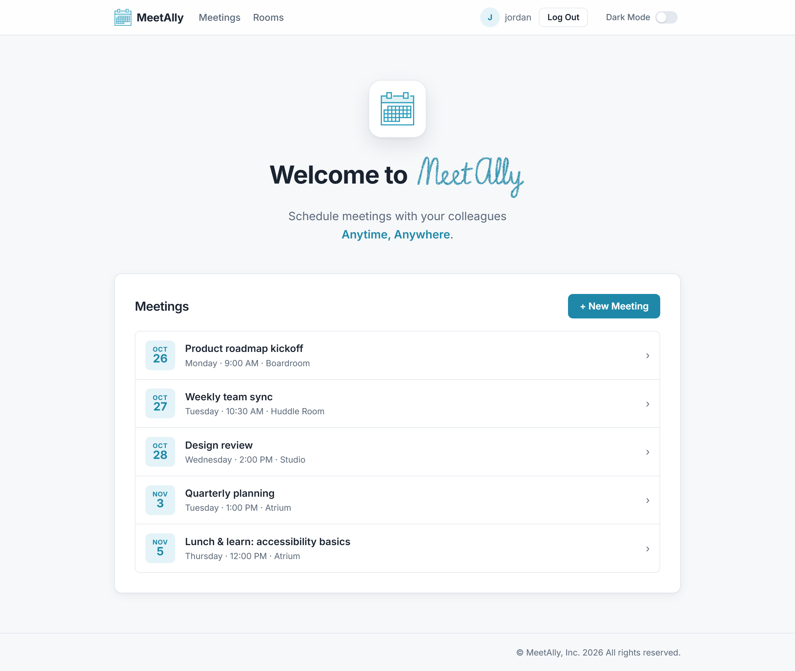

<p align="center">
  
</p>

<h1 align="center">MeetAlly</h1>

<p align="center">
  <strong>Schedule meetings with your colleagues... Anytime, Anywhere.</strong>
</p>

<p align="center">
  
  
</p>

<p align="center">
  <picture>
    <source media="(prefers-color-scheme: dark)" srcset="docs/images/meetings-dark.png">
    
  </picture>
</p>

***MeetAlly*** is a lightweight meeting planner built with `Django`. *Sign up, book a room, invite your colleagues, and see every upcoming meeting at a glance: what it is, when it starts, and where to go.*

The purpose of this project was to learn the `Django` framework; get familiar with its patterns, project structure, inner workings, and how to build effectively with it.

## Features

- **Meetings at a glance**: upcoming meetings listed with date, start time and room.
- **Planning made easy**: pick a title, date, time, duration, room and participants.
- **Rooms directory**: lists every bookable room with its floor and room number.
- **Admin controls**: superusers can add rooms and manage everything in the Django admin.
- **Light and dark mode**: follows your system's settings, with a toggle that remembers your choice.
- **Responsive**: works on desktop and phone screens.

## Getting Started

You need `Python 3.11` or later.

**1. Clone repo and create a virtual environment**

```bash
git clone https://github.com/barboxinha/MeetAlly.git
cd MeetAlly
python -m venv venv
```

Activate it with `venv\Scripts\activate` on Windows, or `source venv/bin/activate` on macOS and Linux.

**2. Install dependencies**

```bash
pip install -r requirements.txt
```

**3. Add a secret key**

MeetAlly reads `SECRET_KEY` from a `.env` file in the project root, which is git-ignored. Generate a key:

```bash
python -c "from django.core.management.utils import get_random_secret_key; print(get_random_secret_key())"
```

Then, create `.env` containing:

```
SECRET_KEY=your-generated-key-here
```

**4. Set up the database and an admin account**

```bash
python manage.py migrate
```

```bash
python manage.py createsuperuser
```

**5. Run the app**

```bash
python manage.py runserver
```

Open *http://localhost:8000*. Sign in as your superuser to add rooms, or use **Sign Up** to create a regular account.
